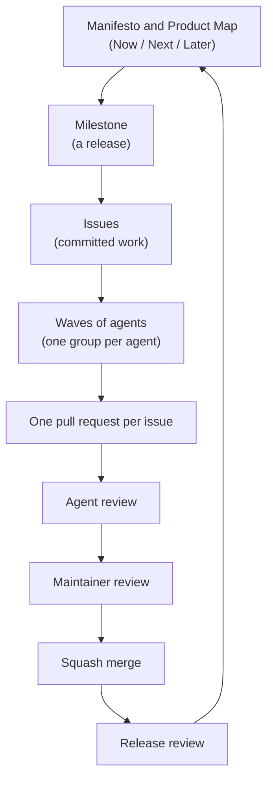

# Workflow

How the skills in this repository fit together. Read this page to see the whole flow,
to look up a term, and to set up a machine and a GitHub repository to run it.

It describes one opinionated way to work, the one these skills implement, not a general
best practice. You can adopt part of it: each skill owns its steps and refers to the
others for theirs, so take those along or replace them with your own rules.

## What it is for

A solo maintainer who runs many AI agents, and who occasionally accepts a pull request
from an external contributor. The maintainer decides what to build and has the final
say on every merge. Agents do the work in between: they write issues, implement them,
review each other's pull requests, and run unattended overnight.

Every repository uses the same workflow and the same configuration. A repository
deviates only for a reason recorded in its `AGENTS.md`, in a section called "Deviations
from the shared workflow".

## The flow

- A **milestone** is the planning unit: one release, with its issues as the committed
  work.
- A **wave** is the groups launched together. The maintainer merges between waves.
- A **brief** is optional. Write one only when work spans several issues or needs
  product decisions settled first.

## Who owns each step

Each skill holds its own rules. This page links to them and does not restate them.

| Step | Skill |
| --- | --- |
| Manifesto, Product Map, Now / Next / Later, briefs, ADRs, release review | [`product-development-system`](../skills/product-development-system/SKILL.md) |
| Issues, triage, labels, pull requests, agent review, merging; repository setup | [`github-workflow`](../skills/github-workflow/SKILL.md) |
| Branch names, and the label to branch type table | [`git-branch`](../skills/git-branch/SKILL.md) |
| Commits, the split check, stacked pull requests | [`git-commit`](../skills/git-commit/SKILL.md) |
| Batches, waves, and groups of unattended agents | [`parallel-issues`](../skills/parallel-issues/SKILL.md) |
| Whole-codebase review of a Python project | [`python-codebase-review`](../skills/python-codebase-review/SKILL.md) |
| Checking the findings of a review file | [`review-verification`](../skills/review-verification/SKILL.md) |

## Glossary

Use these terms and no others. The last column lists the names the workflow retired.

| Term | Meaning | Common name | Don't use |
| --- | --- | --- | --- |
| Manifesto | Written statement of the product's direction: target users, capabilities, principles, non-goals | Product vision statement | |
| Product Map | Coarse map of intended capabilities by user outcome, with the Now / Next / Later roadmap | Capability map; Now/Next/Later roadmap | Milestone plan, backlog |
| Capability | One entry of the Product Map | Capability | Epic |
| Brief | Optional spec for work spanning several issues or needing product decisions: scenario, scope, exclusions, acceptance criteria, appetite | Feature brief (Shape Up: pitch) | Slice brief, slice issue, epic |
| Appetite | Effort the user is willing to spend on a milestone or brief; not an estimate | Appetite (Shape Up) | |
| ADR | A consequential choice with alternatives and consequences; superseded, never rewritten | Architecture Decision Record | Decision record |
| Architecture section | The `AGENTS.md` section holding the project's technical baseline | Architecture overview | Technical foundation |
| Release review | One PR when a milestone's issues are closed: delivered vs planned, artifacts updated | Sprint review (Scrum) | Slice review |
| Parking Lot | Uncommitted ideas: Discussions "Ideas" (public) or private Notion | Icebox | Backlog |
| Milestone | A GitHub milestone, always one release `vX.Y.Z` | Milestone | Milestone plan, board |
| Untriaged / accepted / committed issue | Has `triage` / triaged without milestone / has a milestone | Triage states | Intake issue |
| Change-type label | The one label that sets the branch type and PR title type | Type label | |
| Acceptance criteria | Observable conditions true when done, including failure behavior | Acceptance criteria | Outcome |
| Verification | How anyone confirms the acceptance criteria | Test plan | |
| Default branch | The repository's `main` | Default branch | Trunk |
| Trunk | The branch a stack's bottom PR targets | Trunk (GitHub stacked PRs) | |
| Stack, layer | Dependent PRs, each on the one below; one branch and PR per layer, bottom to top | Stacked PRs | |
| Squash merge | The only merge method; PR title becomes the commit, body blank | Squash and merge | Rebase merge, fast-forward merge |
| Split check | Deciding how to divide changes into branches and PRs | PR splitting | Pre-commit review |
| Deviation | A documented exception in `AGENTS.md` "Deviations from the shared workflow" | | |
| Scratch file | Working material for a task in progress, never committed or cited | Scratch file | |
| Local review | Unattended runs: fresh reviewer checks the diff before each commit | Pre-push review | Pre-commit review |
| Agent review | One per PR or stack, fresh session: acceptance criteria, scope, correctness, consistency | Code review | Spec check |
| Bot review | A hosted review bot's review | Automated code review | |
| Maintainer review | The maintainer's final review before merging | Maintainer review | User review |
| Batch | Issues approved in one planning session | Batch | |
| Wave | Groups launched together; the maintainer merges between waves | Wave (migration planning) | |
| Group | Issues one agent delivers in one worktree as one stack | | Group A, G6 |

"Vertical slice" survives only as a descriptive phrase: thin, end-to-end work. It is
not a kind of issue or document. "Pilot" is not a workflow term either.

A `banned-terms` hook (`.pre-commit-config.yaml`) rejects the retired terms under
`skills/`. Bare "review" when a specific review is meant, and "trunk" for the default
branch, are also to be avoided.

## GitHub setup

[Repository setup](../skills/github-workflow/references/repository-setup.md) lists what
every repository needs: merge methods, rulesets, the label baseline, templates, and
Dependabot. It also holds the reason for squash merges and the rule for documented
deviations.

Files can come from a project template, for example
[Copier](https://copier.readthedocs.io): issue forms, the pull request template, and
Dependabot configuration. Settings, labels, and rulesets can come from infrastructure
as code, for example [OpenTofu](https://opentofu.org). When a repository's agent
instruction files say its GitHub settings are managed as code, agents change them
there through a pull request, never with `gh api` or the web UI.

## Local setup

Install only what the skills you use need.

| Tool | Needed by | Why |
| --- | --- | --- |
| [git](https://git-scm.com) with SSH commit signing | `git-commit`, `github-workflow`, `parallel-issues` | Every commit is signed; squash merges on GitHub are the only merge method |
| [gh](https://cli.github.com) | `github-workflow`, `git-commit`, `parallel-issues` | Issues, pull requests, labels, repository settings |
| `gh` token with the `workflow` scope | `parallel-issues` | Unattended agents push changes under `.github/workflows/` |
| [`github/gh-stack`](https://github.com/github/gh-stack) extension | `git-commit`, `parallel-issues` | Stacked pull requests, one per layer |
| [Herdr](https://herdr.dev) | `parallel-issues` | One workspace per group of agents; run from a Herdr pane |
| [1Password CLI](https://developer.1password.com/docs/cli) (`op`) | `parallel-issues` | Reads the agent's signing key for unattended commits |
| Python 3.10+ | `parallel-issues` | Runs the skill's launcher script |
| [omp](https://omp.sh) | `parallel-issues`, `python-codebase-review` | Agents and reviews run as omp sessions and `task` subagents |
| [uv](https://docs.astral.sh/uv/) | `uv` | Python dependency management; the skill stops when `uv` is missing |
| ruff, a type checker, pytest | `python-codebase-review` | The baseline the review builds on, from the project's own tooling |

Personal policies belong in your own agent instruction files, not in the skills:
working hours, where scratch files live, private notes, and the like.
